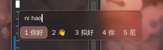

[中文](README.md) | [English](README.en.md)

# Introduction

A frosted-glass Fcitx5 Classic UI candidate window theme for KDE Plasma 6 / KWin Wayland.

The default public install uses WeChat green (`wechat-green`); the locally generated theme lives in `local`.

All source themes are kept under `themes/`.

Preview:



## Installation

```bash
# Default WeChat green #07C160
./install.sh

# Generate and apply the local theme with a specific color
./install.sh --color '#2AAE67'

# Pick an image, sample it, then generate and apply the local theme
./install.sh -p

# Pass the image directly; use double quotes if the path contains spaces
./install.sh -p "/path/to/image file.jpg"
```

Append `--view` to any command to preview the resolved directories and commands without executing anything.

`-p` opens `kdialog` or `zenity` to select an image, extracts the most suitable accent color with ImageMagick, then writes and applies it to `local`.
When `-p` is given without a path, the image picker opens automatically; with a path, that image is sampled directly.

## Theme

The default is WeChat green `#07C160`; `--color` and `-p` generate `local`. Colors are written directly into
`theme.conf` and the SVGs. The background stays transparent, while borders and highlights use the theme color.
Blur is handled by KWin.

Visual design reference: [fcitx5-mellow-themes](https://github.com/sanweiya/fcitx5-mellow-themes).
