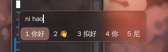

[中文](README.md) | [English](README.en.md)

# 前言

面向 KDE Plasma 6 / KWin Wayland 的 Fcitx5 Classic UI 毛玻璃候选框主题

公开安装默认使用微信绿 `wechat-green`，本地文件夹`local`

源码主题统一放在 `themes/`

预览：



## 安装命令

```bash
# 默认微信绿 #07C160
./install.sh

# 使用指定颜色生成并应用本地主题 local
./install.sh --color '#2AAE67'

# 选择图片，采样后生成并应用本地主题 local
./install.sh -p

# 直接指定图片；路径有空格时使用双引号
./install.sh -p "/path/to/image file.jpg"
```

命令后附加 `--view` 可预览实际目录和执行命令，不执行操作。

`-p` 会通过 `kdialog` 或 `zenity` 选择图片，使用 ImageMagick 提取适合作为
强调色的颜色，再写入并应用 `local`。
`-p` 后面不写图片路径时会自动打开图片选择器；指定路径时直接采样该图片。

## 主题

默认微信绿 `#07C160`；`--color` 和 `-p` 生成 `local`。颜色直接写入
`theme.conf` 和 SVG，背景保持透明，边框与高亮使用主题色。模糊由 KWin
完成。

视觉设计参考 [fcitx5-mellow-themes](https://github.com/sanweiya/fcitx5-mellow-themes)。
